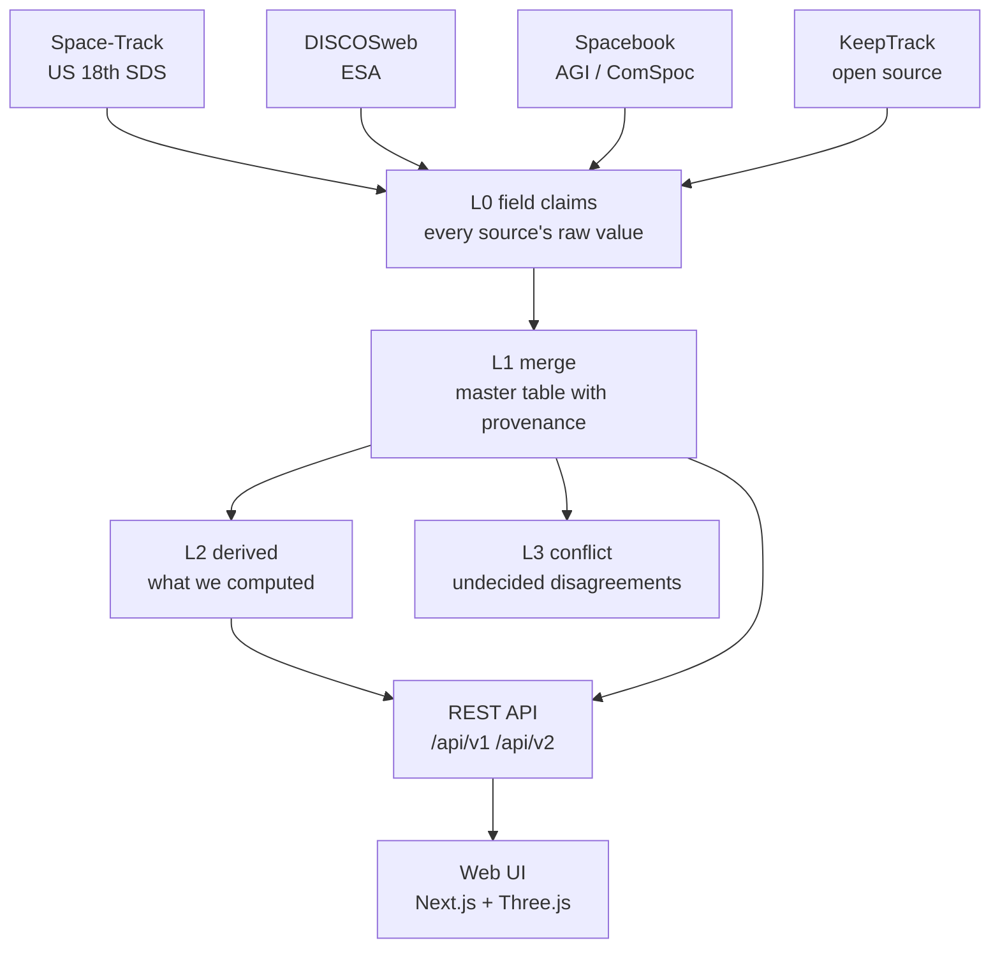
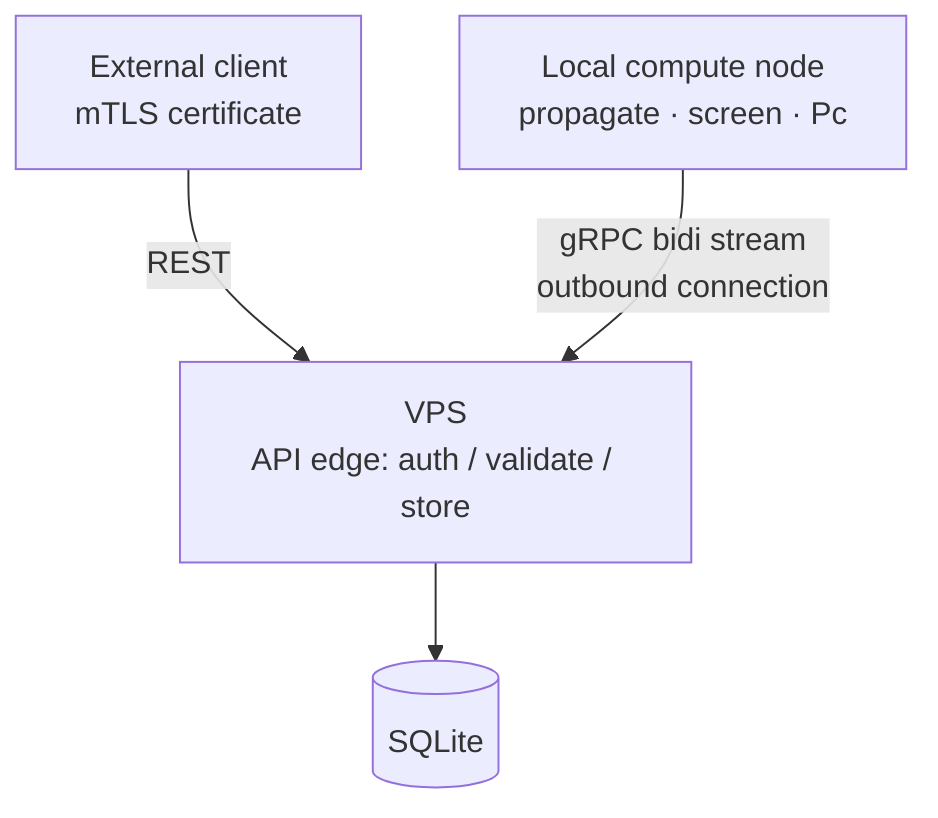

<div align="center">

# Space Safety

**An independent space situational awareness platform for satellite conjunction screening.**

[](CHANGELOG.md)
[](https://www.typescriptlang.org/)
[](https://nextjs.org/)
[](https://sqlite.org/)

[中文](README.zh-CN.md) · **English**

</div>

---

A self-hosted reimplementation of [`space-safety.starlink.com`](https://space-safety.starlink.com).
API names, payload shapes and observable service behaviour match the original;
the implementation and deployment are our own.

**Live:** <https://spacesafety.spacelibre.cn>

---

## What this is

An SSA platform that does not depend on any single vendor's conclusion. It merges the
catalogues of four authoritative sources into one provenance-carrying base, propagates
orbits on top of it, searches for close approaches, computes collision probability, and
serves the result over the same REST surface as Starlink Space Safety.

**Every number can answer "who said this" versus "we computed this"** — observations and
computations live in different tables, and the table name alone is enough to tell them
apart.



---

## The catalogue

All four sources' raw tables are **kept in full**. A 157-column wide table puts every
source's value for the same object side by side.

> Figures measured **2026-11-05**. Reproduce with `npm run data:health`.
> Sources update daily, so the numbers drift a little.

| Data                                       | Size                          |
| ------------------------------------------ | ----------------------------- |
| Wide table `catalogue_wide`                | **72,435 rows × 157 columns** |
| L0 field claims (every source's value)     | **2,633,721**                 |
| L1 master table `master_object`            | **72,375** objects            |
| Per-source elements `object_sources`       | **64,153** rows               |
| Canonical element set `master_element_set` | **32,932** objects            |

Single-source tables: Space-Track SATCAT 71,231 · merged SATCAT 72,310 · DISCOS objects
71,176 · KeepTrack 35,224 · fragmentation events 673.

Classification (`object_classification`, covering all 72,435 rows):

| Orbit regime |  Count | Purpose           | Count |
| ------------ | -----: | ----------------- | ----: |
| LEO          | 64,921 | Communication     | 7,274 |
| HEO          |  3,459 | Military comms    |   533 |
| GEO          |  1,792 | Technology        |   375 |
| MEO          |  1,743 | Navigation        |   375 |
| UNKNOWN      |    520 | Earth observation |   338 |

> **Gaps are left as gaps.** 520 objects have an unknown orbit regime and 1,539
> on-orbit objects have no hard-body radius. Those stay null rather than being inferred
> from the object's name. See [`docs/CATALOGUE-GAPS.md`](docs/CATALOGUE-GAPS.md).

---

## Conjunctions and collision probability

Two independent screens are shown **side by side and never merged**, because they are
two different claims:

| Source                             |                                  Size | What it is                                                           |
| ---------------------------------- | ------------------------------------: | -------------------------------------------------------------------- |
| Space-Track CDM                    | **3,728 messages → 598 conjunctions** | 18th SDS screening public elements; no covariance, no operator claim |
| CelesTrak SOCRATES                 |                    **186,789 events** | CelesTrak's own screening over its own elements                      |
| Space-Track TIP                    |                                26,248 | Re-entry predictions                                                 |
| Predicted re-entry / fragmentation |                              13 / 673 | KeepTrack, DISCOS                                                    |

Where they agree the event is corroborated. Where they disagree, one element set has
gone stale — **that is precisely what the comparison is for.**

Collision probability is computed with the **Alfano method**, matching the published
Starlink documentation. Both the `2D` and `3D` specifications are implemented.

---

## Stack

| Layer        | Choice                                                     |
| ------------ | ---------------------------------------------------------- |
| Language     | TypeScript — every script and tool included, **no Python** |
| Web          | Next.js 15 App Router + React 19                           |
| 3D           | Three.js / Cesium for orbit visualisation                  |
| Storage      | SQLite (`better-sqlite3`)                                  |
| Worker comms | gRPC bidirectional stream (`proto/worker.proto`)           |
| Auth         | mTLS client certificates (`npm run cert:issue`)            |

**326 TypeScript files, roughly 76,000 lines.**

---

## Deployment topology



Computation stays local; the VPS is only an edge. Propagation and screening are
CPU-bound and long-running, so putting them behind the request path would block requests
and inflate cost. The worker dials out, so the VPS never needs inbound access to the
private network.

---

## Interface

Six languages — 简体中文 / English / Español / Français / Deutsch / 日本語 — switchable
from the sidebar. Every string comes from `src/lib/i18n/messages/`; a missing key fails
`npm run check`.

Colours and logo follow the [spacelibre visual identity](https://github.com/spacelibres/vi).

Nineteen main pages: catalogue (list / faceted browse / statistics / detail),
conjunctions, SOCRATES screening, re-entry, space environment, launches and
fragmentations, 3D models, trajectories, operators, keys and users.

---

## Data discipline

This is scientific data, not a demo. Four rules, each one learned the hard way:

1. **Units follow the physics, not the field name.** Space-Track's CDM `MIN_RNG` is in
   **metres**; the same concept in CelesTrak's `TCA_RANGE` is in **kilometres**. We were
   wrong by a factor of 1000 for a while by trusting the name.
2. **Sentinel values are not data.** CelesTrak writes `1.000E+00` for "probability not
   computed". It is dropped at ingest, because a probability of 1 cannot be told apart
   from a certain collision.
3. **Gaps stay empty.** No inferring orbit regime from names, no backfilling missing
   values with a language model.
4. **A subset is not the whole.** KeepTrack republishes SOCRATES as 10 rows — all of them
   one already-docked pair. The CelesTrak source file has 197,600. We fetch the source.

---

## Health check

```bash
npm run data:health
```

Answers "did last night's ingest actually work" on one screen. It reports each source's
last _attempt_ next to its last _success_ (`ok` is not freshness), derived-table row
counts beside their input tables (an empty table is not an empty source), and every
record carrying an `error` — including an HTTP 200 whose body is an error.

---

## API

18 endpoints, same names and shapes as the original.

| Resource   | Endpoints                                                                                                                             |
| ---------- | ------------------------------------------------------------------------------------------------------------------------------------- |
| Operator   | `GET/POST /api/v1/operator`, `GET/PATCH /api/v1/operator/:id`                                                                         |
| Object     | `GET/POST /api/v1/object`, `GET/PATCH/PUT /api/v1/object/:id`                                                                         |
| Trajectory | `GET/POST /api/v1/trajectory`, `GET /api/v1/trajectory/:id`, `GET /api/v1/trajectory/:id/metadata`, `GET /api/v2/trajectory/:id/cdms` |
| CDM        | `GET /api/v2/cdm`, `GET /api/v1/cdm/:id`, `GET /api/v1/cdm/:id/metadata`                                                              |
| Event      | `GET /api/v2/event/:id`, `GET /api/v1/event/:id/cdms`                                                                                 |

Behaviour worth knowing:

- **mTLS only.** No client certificate yields `401 RBAC: access denied`.
- **Streaming pagination.** Reuse the token to fetch increments; an expired token yields
  `400 pagination_too_old`.
- **Error envelope:** `{ correlation_id, error, error_type, metadata }`.
- `hypothetical` trajectories and their CDMs are visible only to the submitter.
- `spacex_optical` trajectory content is unreadable — only its CDMs are exposed.

---

## Numerical core

| Module                | Implementation                                                     |
| --------------------- | ------------------------------------------------------------------ |
| Propagation           | Two-body + J2, RK4                                                 |
| Frames                | Full IAU-76/FK5 ITRF↔J2000 (precession/nutation/GMST/polar motion) |
| Close approach        | Screening box 2 / 44 / 51 km (RTN), golden-section TCA refinement  |
| Collision probability | 2D Alfano, polar integration about the hard-body disc              |

Accuracy: Alfano agrees with an independent reference integral to **0.00 %**. ITRF→J2000
semi-major axis drifts 23.6 km over 7 days, with covariance-trace conservation error of
**1e-15**.

## Ephemeris formats

| Format             | Support                             |
| ------------------ | ----------------------------------- |
| CCSDS OCM          | ✅ including manoeuvre plan parsing |
| CCSDS OEM          | ✅ covariance blocks not yet read   |
| Modified ITC       | ✅                                  |
| JSpOC / UTC / NASA | recognised, parser not yet written  |

---

## Getting started

```bash
npm install
cp .env.example .env.local   # fill in credentials as needed; not committed
npm run demo:seed            # 5 real Starlink satellites
npm run demo:conjunction -- --seed   # derive a cooperative target, produce a conjunction
npm run build && npx next start -p 3000
```

Open <http://localhost:3000>.

Demo mode needs two environment variables (a missing one makes the API return `401`):

```bash
SPACE_SAFETY_ALLOW_X_OPERATOR=1 SPACE_SAFETY_DEMO=1 npx next start -p 3000
```

Real Starlink satellites do not approach each other — their operators keep it that way
with active collision avoidance. So demo conjunctions come from a cooperative target
derived from real ephemerides (`--emit` exports it as an ITC file).

---

## Distributed run

```bash
# VPS
SPACE_SAFETY_WORKER_TOKEN=secret npm run vps        # gRPC :50051

# compute node
SPACE_SAFETY_GRPC_INSECURE=1 \
SPACE_SAFETY_GRPC_HOST=vps.example.com:50051 \
SPACE_SAFETY_API_ORIGIN=https://vps.example.com \
SPACE_SAFETY_WORKER_TOKEN=secret \
npm run worker
```

Verified end to end: upload → enqueue → dispatch over gRPC → fetch ephemeris → compute →
return → CDM stored.

---

## Testing

```bash
npx tsc --noEmit && npm test && npm run check
```

53 suites, 993 assertions. Suites are discovered from `tests/*.test.ts`, so a new test
file needs no registration — the hand-maintained list had silently skipped two suites.

```bash
npm run bench -- --count 200 --offline
```

Measures end-to-end screening throughput on real ephemerides and hard-asserts the
prefilter at the end: dropping a single real conjunction fails the benchmark. Results,
including the unfavourable ones, are in `docs/ARCHITECTURE.md`.

---

## Production notes

1. **mTLS must terminate at the TLS layer**, forwarding the certificate as
   `X-Client-Cert` (nginx: `$ssl_client_escaped_cert`).
2. **The compute channel must use TLS:** `SPACE_SAFETY_GRPC_CERT/KEY/CA`. The process
   refuses to start in production without it.
3. `SPACE_SAFETY_DEMO` and `SPACE_SAFETY_ALLOW_X_OPERATOR` are for demos only. Do not set
   them in production.

---

## Naming

The project is **spacesafety** — one name across code, config, database and gRPC package:

| Location                       | Value                                                         |
| ------------------------------ | ------------------------------------------------------------- |
| Package / directory / database | `spacesafety`, `data/spacesafety.sqlite`                      |
| Environment prefix             | `SPACE_SAFETY_` (full list in [`.env.example`](.env.example)) |
| gRPC package                   | `spacesafety.worker.v1`                                       |
| Demo auth header               | `x-space-safety-operator`                                     |

## No computed data in the repository

Ephemeris caches, SQLite databases and Spacebook downloads total hundreds of GB and are
**not committed** (see `data/*` in `.gitignore`). Re-download them per
[`docs/DATA-SOURCES.md`](docs/DATA-SOURCES.md). Certificate private keys (`certs/*.key`)
and the credentials in `.env.local` are likewise excluded.

---

## Documentation

| File                                                 | Contents                                                                     |
| ---------------------------------------------------- | ---------------------------------------------------------------------------- |
| [`docs/CATALOGUE-FINAL.md`](docs/CATALOGUE-FINAL.md) | Catalogue definition (authoritative)                                         |
| [`docs/CATALOGUE-GAPS.md`](docs/CATALOGUE-GAPS.md)   | Known gaps                                                                   |
| [`docs/ARCHITECTURE.md`](docs/ARCHITECTURE.md)       | Architecture and numerical core                                              |
| [`docs/DATA-SOURCES.md`](docs/DATA-SOURCES.md)       | What each source offers and how to fetch it                                  |
| [`docs/SPEC-BEHAVIOR.md`](docs/SPEC-BEHAVIOR.md)     | Service behaviour spec — the implementation basis, with a citation per claim |
| [`docs/UI-SPEC.md`](docs/UI-SPEC.md)                 | Visual and layout spec (from the official screenshots)                       |
| [`CONTRIBUTING.md`](CONTRIBUTING.md)                 | Stack constraints and commit rules                                           |

Reference material: [`docs/reference-screenshots/`](docs/reference-screenshots/) (27 official
screenshots) and [`docs/starlink-space-safety/`](docs/starlink-space-safety/) (local snapshot
of the 33-page official documentation).

---

## Versioning

The patch number increments on every iteration (`0.1.65` → `0.1.66` → …) and must agree
across `package.json`, `package-lock.json`, the git tag and `CHANGELOG.md`. See
[`CHANGELOG.md`](CHANGELOG.md) for the full history.
