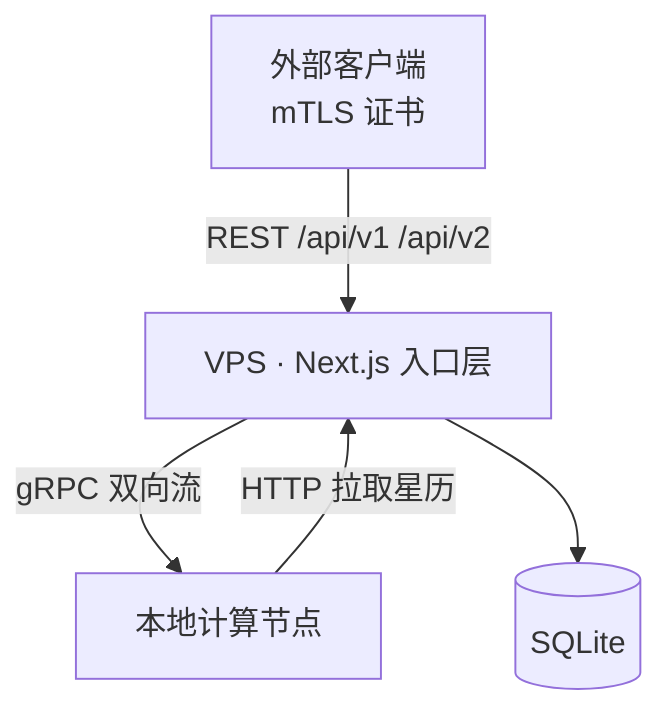

# Space Safety

仿制 `space-safety.starlink.com` 的卫星轨道安全与交会筛查平台。
API 名称、数据结构与服务行为与原站一致；实现与部署方式是我们自己的。

当前版本 **0.1.57** —— 完整变更记录见 [`CHANGELOG.md`](CHANGELOG.md)。

> **版本规则**：每次迭代只递增补丁号（`0.1.57` → `0.1.58` → …），
> 并同步更新 `package.json`、`package-lock.json`、git tag 与 `CHANGELOG.md`。
> 提交前请确认这四处一致。

## 项目规则

技术栈、面向对象标准、版本规则与提交前检查写在 [`CONTRIBUTING.md`](CONTRIBUTING.md)，
是约束性文件。提交前请跑：

```bash
npx tsc --noEmit && npm test && npm run check
```

## 多语言

界面支持 6 种语言：简体中文、English、Español、Français、Deutsch、日本語。
语言由 `locale` cookie 决定，侧栏可切换；文案全部来自
`src/lib/i18n/messages/`，`npm run check` 会拦截缺失、多余或空白的键。

## 命名约定

项目名 **spacesafety**，代码、配置、数据库与 gRPC 包名统一使用这一个名字：

| 位置 | 值 |
|---|---|
| 包名 / 目录 / 数据库文件 | `spacesafety`、`data/spacesafety.sqlite` |
| 环境变量前缀 | `SPACE_SAFETY_`（全量清单见 [`.env.example`](.env.example)） |
| gRPC 包 | `spacesafety.worker.v1` |
| 演示认证头 | `x-space-safety-operator` |

## 仓库不含计算数据

星历缓存、SQLite 数据库与 Spacebook 下载文件合计上百 GB，**不入版本库**
（见 `.gitignore` 中的 `data/*`）。克隆后按 `docs/DATA-SOURCES.md` 重新下载即可。
证书私钥（`certs/*.key`）与 `.env.local` 中的凭据同样不入库。

## 快速开始

```bash
npm install
cp .env.example .env.local   # 按需填写凭据；该文件不入库
npm run demo:seed            # 5 颗真实 Starlink 卫星
npm run demo:conjunction -- --seed   # 派生合作目标，产生交会事件
npm run build && npx next start -p 3000
```

打开 <http://localhost:3000>。

演示模式需要两个环境变量（缺一则 API 抛 `401`）：

```bash
SPACE_SAFETY_ALLOW_X_OPERATOR=1 SPACE_SAFETY_DEMO=1 npx next start -p 3000
```

## 参考材料

| 文件 | 内容 |
|---|---|
| [`docs/SPEC-BEHAVIOR.md`](docs/SPEC-BEHAVIOR.md) | ★ 服务行为规格——实现依据，每条附官方出处 |
| [`docs/ARCHITECTURE.md`](docs/ARCHITECTURE.md) | 部署拓扑、职责划分、数值内核说明 |
| [`docs/UI-SPEC.md`](docs/UI-SPEC.md) | ★ 界面视觉与布局规格（依据官方截图） |
| [`docs/DATA-SOURCES.md`](docs/DATA-SOURCES.md) | 数据源：官方公开星历入口 |
| [`docs/ONBOARDING.md`](docs/ONBOARDING.md) | 官方 mTLS 凭证申请指南 |
| [`docs/reference-screenshots/`](docs/reference-screenshots/) | 官方界面截图 27 张 |
| [`docs/starlink-space-safety/`](docs/starlink-space-safety/) | 官方文档本地快照（33 页） |

## 架构



- **VPS**：认证、校验、存取、组装响应。不做轨道计算。
- **计算节点**：传播、接近搜索、Alfano Pc。主动外连，无需公网 IP。

## 已实现

### API（18 个端点，与官方同名同构）

| 资源 | 端点 |
|---|---|
| Operator | `GET/POST /api/v1/operator`、`GET/PATCH /api/v1/operator/:id` |
| Object | `GET/POST /api/v1/object`、`GET/PATCH/PUT /api/v1/object/:id` |
| Trajectory | `GET/POST /api/v1/trajectory`、`GET /api/v1/trajectory/:id`、`GET /api/v1/trajectory/:id/metadata`、`GET /api/v2/trajectory/:id/cdms` |
| CDM | `GET /api/v2/cdm`、`GET /api/v1/cdm/:id`、`GET /api/v1/cdm/:id/metadata` |
| Event | `GET /api/v2/event/:id`、`GET /api/v1/event/:id/cdms` |

行为要点：
- **mTLS 认证**，未携带证书返回 `401 RBAC: access denied`
- **流式分页**：复用 token 取增量，过期返回 `400 pagination_too_old`
- **错误信封**：`{ correlation_id, error, error_type, metadata }`
- `hypothetical` 轨迹及其 CDM 仅提交方可见
- `spacex_optical` 轨迹内容不可读取，只能看 CDM

### 数值内核

| 模块 | 实现 |
|---|---|
| 传播 | 二体 + J2，RK4 |
| 参考系 | ITRF↔J2000 完整 IAU-76/FK5（岁差/章动/GMST/极移） |
| 接近搜索 | 筛查盒 2 / 44 / 51 km（RTN），黄金分割精修 TCA |
| 碰撞概率 | 二维 Alfano，以硬体圆盘为中心的极坐标积分 |

精度验证：Alfano 与独立参考积分误差 **0.00%**；ITRF→J2000 半长轴
跨 7 天漂移 23.6 km，协方差迹守恒误差 **1e-15**。

### 星历格式

| 格式 | 支持 |
|---|---|
| CCSDS OCM | ✅ 含机动计划解析 |
| CCSDS OEM | ✅ 协方差段暂忽略 |
| Modified ITC | ✅ |
| JSpOC / UTC / NASA | 已识别，解析待补 |

### Web UI

按 `docs/UI-SPEC.md` 复刻官方布局：

- 左侧栏 + 环境横幅 + UTC 时钟 + 搜索
- Home（统计 + 3D 轨道视图 + 风险表）
- Operators / Objects / Trajectories / Conjunctions 列表与详情
- 交会详情含 Pc 演化图（对数轴）
- 轨迹详情含轨道根数图（SMA/Inc/Ecc/RAAN/AoP/MA 切换）
- CDM 支持 `json` / `kvn` 下载

## 演示数据

```bash
npm run demo:seed                    # 5 颗真实 Starlink 卫星
npm run demo:conjunction -- --seed   # 派生一个合作目标，产生交会
```

实测输出：8 个交会事件，Pc 覆盖 `1.7e-8` 到 `3.8e-2`。

真实 Starlink 卫星之间不会接近（由主动避碰维持），所以交会事件来自
一个由真实星历派生的合作目标（`--emit` 可导出为 ITC 文件）。

## 分布式运行

```bash
# VPS
SPACE_SAFETY_WORKER_TOKEN=secret npm run vps        # gRPC :50051

# 计算节点
SPACE_SAFETY_GRPC_INSECURE=1 \
SPACE_SAFETY_GRPC_HOST=vps.example.com:50051 \
SPACE_SAFETY_API_ORIGIN=https://vps.example.com \
SPACE_SAFETY_WORKER_TOKEN=secret \
npm run worker
```

已验证闭环：上传 → 入队 → gRPC 下发 → 拉取星历 → 计算 → 回传 → CDM 入库。

## 测试

```
$ npm test
…（38 个套件，每个套件独立进程）…
All 38 suites passed.
```

38 个套件、786 条断言。套件清单由 `tests/*.test.ts` 自动发现，
新增测试文件无需再登记（登记名单曾是手写的，因此漏跑过两个套件）。

## 压测

```
$ npm run bench -- --count 200 --offline
```

测真实星历上的端到端筛查吞吐，并在最后对预筛做硬断言：预筛丢掉的任何一个
交会都会让压测失败。结论（包括不利的部分）见 `docs/ARCHITECTURE.md` 的性能一节。

## 生产部署注意

1. **mTLS 必须在 TLS 终止层完成**，并把证书以 `X-Client-Cert`
   透传给应用（nginx: `$ssl_client_escaped_cert`）。
2. **计算通道必须启用 TLS**：`SPACE_SAFETY_GRPC_CERT/KEY/CA`。
   未配置时生产环境会拒绝启动。
3. `SPACE_SAFETY_DEMO` 与 `SPACE_SAFETY_ALLOW_X_OPERATOR` 仅供演示，
   生产环境不要设置。
