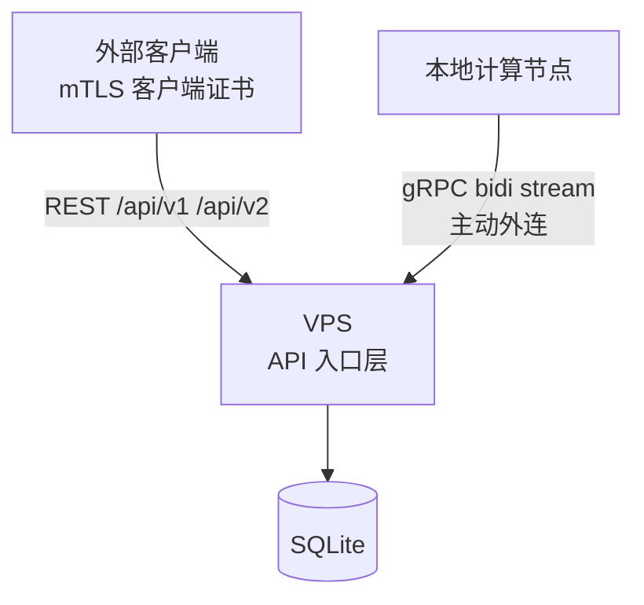
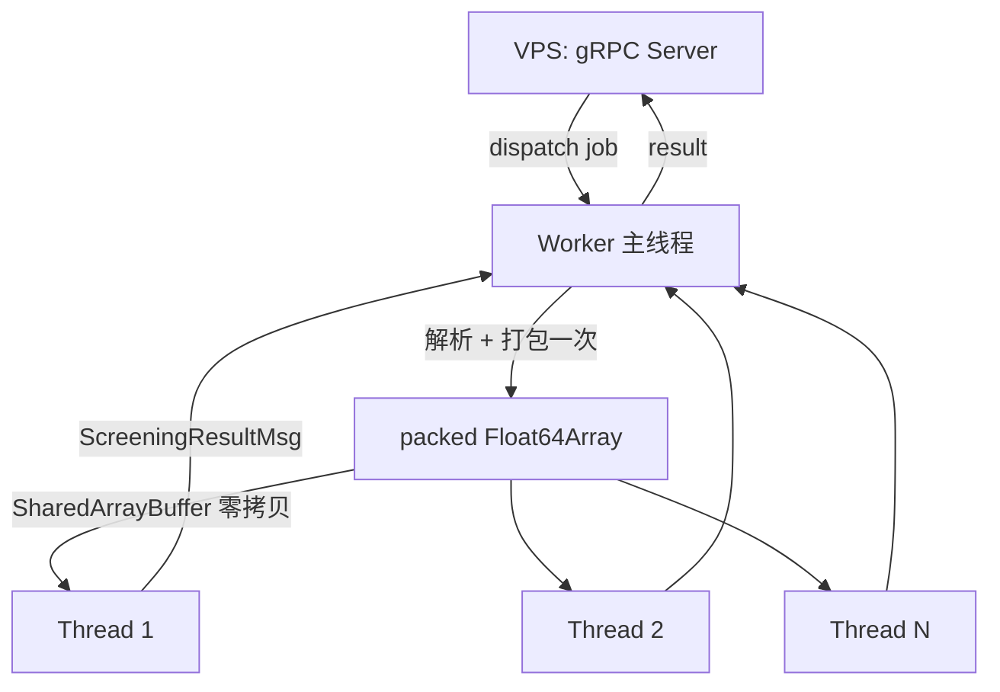

# Space Safety — 架构说明

仿制 `space-safety.starlink.com` 的全栈平台。API 名称、请求/响应结构、
以及可观察的服务行为与官方一致（依据见 `SPEC-BEHAVIOR.md`）。

## 部署拓扑



### 职责划分

| 组件 | 位置 | 职责 | 明确不做 |
|---|---|---|---|
| **API 入口** | VPS | 认证（mTLS）、参数校验、存取数据、组装响应、限流 | 轨道计算、Pc 计算 |
| **计算节点** | 本地机器 | 轨道传播、接近搜索、Alfano Pc、生成 CDM | 对外暴露端口、持久化 |

**为什么计算不放在 VPS**：投影/筛查是 CPU 密集且可能长时间运行的任务，
放在入口层会阻塞请求并放大成本。VPS 保持轻量、无状态化。

### 为什么是 gRPC 双向流

- **计算节点主动外连**并经长连接保持在线，VPS 不需要反向访问内网，
  无需公网 IP 或内网穿透。
- 任务下发与结果回传**共用一条连接**，省去回调端点的鉴权与暴露面。
- 背压天然：节点只在有空闲时才上报 `hello`/心跳中的容量，
  调度器不会把它压垮。
- 相比轮询，没有轮询延迟（官方也强调筛查应"通常 < 1 分钟"出结果）。

## 代码结构

```
proto/worker.proto            # VPS ↔ 计算节点 的唯一契约
src/lib/grpc/proto.ts         # proto 动态加载 + 消息类型

src/lib/core/                 # ★ 数值内核（纯函数，无 IO，全部有测试）
  linalg.ts                   #   向量/矩阵、RTN 基、对称矩阵特征分解
  propagator.ts               #   二体 + J2 的 RK4 传播、状态转移矩阵
  alfano.ts                   #   二维 Alfano 碰撞概率
  screening.ts                #   筛查盒判定、TCA 精修、CDM 字段组装

src/lib/orbit/                # 可视化用：OEM 解析 + ITRF→ECI 坐标变换
src/db/                       # Drizzle schema + SQLite 连接
docs/                         # 官方文档快照 + 规格 + 交接说明
tests/                        # 数值内核测试
```

## 数值内核

内核刻意做成**纯函数、零依赖、可单测**，因为这是仿制中最容易出错、
也最需要与官方行为对齐的部分。

### 筛查盒

维度表已在 `screening.ts` 中具名导出，并有测试锁定防止漂移：

| 方向 | 半宽 |
|---|---|
| 径向 R | 2 km |
| 沿轨 T | 44 km |
| 离轨 N | 51 km |

盒子随**主对象的速度**旋转（RTN 基）。判定为双向：
主对象盒 ∩ 次对象轨迹，或次对象盒 ∩ 主对象轨迹。

### TCA 搜索

1. 以可配步长（默认 60 s，受 `maxSamplePoints` 预算约束）扫描两条轨迹的**时间重叠区**。
2. 检测**距离的局部极小**（距离率由负转正的变号点），而不是"第一次进盒"。
3. 对每个变号区间用**黄金分割搜索**精修至毫秒级。
4. 精修后若 RTN 任一分量超出对应半宽，则不报告——避免用外接球误收远距接近。
5. TCA 相距 20 分钟内的结果合并（与官方 Event 归组规则一致）。

### 碰撞概率

二维 Alfano 方法，**以硬体圆盘为中心**做极坐标积分。

这个选择很关键：LEO 场景中硬体半径约 5 m 而位置 σ 约 1 km，
若以分布均值为中心积分，需要极高阶角向求积才能分辨那条极细的环，
结果会下溢。以圆盘为中心则被积函数在整个域内都是 O(1)。

精度验证（σ = 1 km，R = 5 m，偏差 d 沿 +x）：

| d (km) | 独立参考值 | 内核输出 |
|---|---|---|
| 0.5 | 1.1031e-5 | 1.1031e-5 |
| 1.0 | 7.5816e-6 | 7.5816e-6 |
| 3.0 | 1.3887e-7 | 1.3887e-7 |
| 8.0 | 1.5833e-19 | 1.5833e-19 |

参考值由独立的极坐标高分辨率积分生成，与内核实现路径不同。

**NULL Pc 规则**（照搬官方 CDM 行为）：任一方缺协方差、协方差非半正定、
或相对速度过低导致交锋面不成立时，CDM 仍然生成，但 `probability_of_collision`
为 `NULL`，并记录原因。

## 测试

```bash
npm test              # 两个套件一起跑
npm run test:alfano   # 概率内核（11 项）
npm run test:screening# 筛查流水线（18 项）
```

筛查测试不从天文几何里"找"有趣场景（那样期望值难以证明），
而是**直接按期望的相对运动构造状态序列**：把次对象放在主对象
RTN 系下的已知偏移轨迹上，让最近距离与 TCA 解析可算，
因此断言的是精确值而不是宽松区间。

## 当前状态

| 层 | 状态 |
|---|---|
| 官方文档本地化（33 页 + 端点清单） | ✅ |
| 服务行为规格 | ✅ `SPEC-BEHAVIOR.md` |
| 界面规格 + 27 张官方截图 | ✅ `UI-SPEC.md` |
| gRPC 契约 | ✅ `proto/worker.proto` |
| 数值内核（传播 / 筛查 / Pc / 坐标变换） | ✅ |
| 星历解析（OCM / OEM / Modified ITC / UTC / JSpOC / NASA） | ✅ |
| TLE / OMM 解析 + SGP4 传播（含 Alpha-5、TEME→J2000） | ✅ |
| 轨迹数据源分层（OCM/ITC vs TLE） | ✅ `source-policy.ts` |
| Space-Track 目录接入（NORAD id 解析） | ✅ |
| 观测源（`spacex_optical`） | ✅ |
| SQLite schema + 分页 token | ✅ |
| API 入口层（18 个端点） | ✅ |
| mTLS 证书签发工具 | ✅ `npm run cert:issue` |
| 计算节点 + gRPC 通道 | ✅ 端到端验证 |
| Web UI + Three.js 轨道视图 | ✅ |
| 预测精度面板 | ✅ |
| 规模压测（含预筛硬断言） | ✅ `npm run bench` |
| 径向预筛（采样直方图） | ✅ `src/lib/core/radial-prefilter.ts` |
| 时空窗口剪枝 | ✅ `src/lib/core/time-windows.ts` |
| 多核计算线程池 | ✅ `src/worker/pool.ts` |
| OCM/ITC 双源合并（含打包路径） | ✅ `feed-combination.ts` + pool 接线 |
| 测试 | ✅ 438 项 / 22 套件 |

## 性能

`npm run bench` 在真实 Starlink 星历上测端到端筛查（解析 → 内插 → 盒判定 →
TCA 精修 → Alfano Pc）。单核数据在 3 天窗口、4321 状态点时：

| 项目 | 开发初期 | 现在 | 手段 |
|---|---|---|---|
| 单对耗时 | 25 ms | 0.65 ms | 扁平 `Float64Array`、零分配内插、track LRU、时空窗口 |
| 全星座外推 | 333 h | 9–10 h | 同上 |

优化过程中的三个关键改动（每一项都是可复现的瓶颈，不是猜测）：

1. **轨道改用扁平 `Float64Array`**（stride 7：`t, px, py, pz, vx, vy, vz`）。
   原先每个状态是一个对象，4321 状态意味着 8642 个对象头部与指针追逐，
   `toTrack` 一项就占单对耗时的一半（7.0 ms → 1.3 ms）。
2. **内插零分配**。粗扫循环调用内插两万次，每次返回两个新数组是主要 GC 来源。
   改为写入调用方提供的缓冲区后，内循环 GC 归零。
3. **track 缓存**。真实扫描里每颗星要与多颗星比对，`toTrack` 于是从「每对一次」
   变成「每星一次」。缓存键是**内容指纹**（含端点状态与协方差存在性），
   不是 trajectory id——id 只在上传内唯一，用 id 会取到过期轨道。

### 时空窗口剪枝（同星座内的关键提速）

径向预筛对同星座无效，所以要靠第二个手段：**时空窗口**。
实现在 `src/lib/core/time-windows.ts`。

思路：卫星不是占满整条轨道，而是在某一时刻只在一个位置。两条轨道只有在
**同一时间、彼此靠近**时才可能交会。于是把轨迹按时间切片，每片算一个位置包围盒，
只有包围盒相交**且**时间重叠的片对才值得送进 kernel。

实测（150 颗三星层星座，367 个交会）：

| 窗口 | 剪枝率 | 总耗时 | 漏检 |
|---|---|---|---|
| 无剪枝 | 0% | 12.6 s | — |
| 0.5 min | 80% | 3.7 s | 0 |
| 2 min（默认） | 72% | 3.9 s | 0 |
| 7.5 min | 46% | 6.4 s | 0 |
| 30 min | 0% | 11.6 s | 0 |

默认取 2 分钟：曲线在 2 分钟以下已经走平（窗口再短，片内只有一两个样本，
包围盒收益递减），并且 2 分钟比 Starlink 的 60 s 采样间隔更宽，给稀疏星历留了余量。

### 窗口 padding：两处都踩过的坑

padding 必须覆盖两件事，缺一不可：

1. **盒半边对角长** 67.4 km——交会是按相对位置落进盒判定报告的最小间距。
2. **一个采样步长的轨道运动**——约 460 km（60 s × 7.6 km/s）。

第 2 条是真正的坑。包围盒只覆盖**采样到**的位置，而 kernel 在样本**之间**做插值。
窗口只包含一个样本时，盒退化成一个点，而 TCA 处的真实位置可能离它大半步——
实测 30 s 窗口因此丢了 13/367 个交会。

修的时候还踩了第二个坑：一开始按**窗口长度**算步长，结果 7.5 分钟窗口的 padding
膨胀到 3400 km，剪枝率直接归零。正确的量是**采样间隔**，不是窗口长度。

### 另一处双指针缺陷

`pairNeedsScreening` 最初用双指针：谁先结束谁前进，只比较当前一对。窗口等长且无
空洞时没问题，但轨迹一旦有空洞（丢样本、短弧段），指针就会互相滑过而从不比较
真正重叠的窗口。改成归并式：对每个 A 窗口推进 `jStart` 到第一个可能重叠的 B 窗口，
然后扫到不再重叠为止。

### 预筛：采样半径直方图

预筛的实现在 `src/lib/core/radial-prefilter.ts`：把每条轨迹**所有采样状态的半径**
按 5 km 分箱，得到径向占用直方图；只有当两边的占用箱永远相隔超过「盒触及范围」
（`hypot(2,51) + 2 = 53 km`）时才拒绝。

用采样而不是单点轨道根数，是因为单点的 apogee/perigee 只描述一个瞬间。
真实 Starlink 弧段 e ≈ 1e-3，整圈半径会扫 7 km，两条轨道可能在某瞬间相隔很远、
换个相位又重合。

### 预筛的价值边界（实测）

| 场景 | 拒绝率 |
|---|---|
| Starlink 内部（485 / 472.5 / 462.5 km 壳层互筛） | **0%** |
| Starlink vs OneWeb / Iridium / 800 km 碎片带 / GPS / GEO | **100%** |

同星座内拒绝率是 0%，这不是缺陷，是几何决定的：官方三个主要壳层相隔
10–22.5 km，而盒触及范围是 53 km，加上偏心摆幅后要隔 67 km 以上才可能拒绝。
所以预筛的价值在**跨族筛查**，不在同星座内部。压测同时输出这两个数字，
避免把 0% 误读成 bug，也避免误以为预筛是免费的。

### 被否掉的两个判据（都会漏检）

| 判据 | 后果 | 错在哪 |
|---|---|---|
| `R·θ < 盒` | 丢 1299 个交会 | 该式只在等高圆轨道成立；半径不等时两轨道可在交点处相遇，θ 再大也不影响 |
| 带间隙 `< 2 km` 早退 | 丢 577 个交会 | 早退阈值与 `prefilter` 接受阈值不一致，2–54 km 的带间隙被跳过 |

两条都做成了回归测试（`tests/prefilter.test.ts`），并在 `npm run bench` 里做成
硬断言：预筛丢掉的任何一个交会都会让压测失败。

### 配对方向必须对称（已修复的缺陷）

筛查结果必须与主/次目标的传入顺序无关。这正是压测抓出来的：
同一对卫星正向报 7 个交会、反向只报 5 个，且 TCA 完全相同。

有两个独立的成因，都已修复：

1. **TCA 处只查了主目标的盒子。** 粗扫阶段是双向判定（主在次的盒里也算），
   但 `buildApproach` 只查主目标的盒子。边界上的交会于是只在一个方向上幸存。
2. **两侧用了不同的盒判定实现。** 粗扫用标量版 `inBoxScalar`，TCA 用矩阵版
   `rtnBasis` 投影。两者数学等价，浮点舍入不等价，边界样本会翻面。

现在 TCA 处也调用 `inBoxScalar`，先查主、不中再查次，与粗扫完全一致。
`tests/determinism.test.ts` 专门用一个「擦边」夹具（70°/472.5 km 与
97.3°/462.5 km，相隔 10 km）锁死这个行为，并且断言"确实产出了交会"，
防止夹具退化成空跑而测试假通过。

### 一个值得记录的物理事实

真实的 72 面 70° 壳层里，任意两个**不同轨道面**的最近距离是 562 km
（最近面夹角 4.7°），远超 51 km 的盒。所以同壳层筛查的候选只来自
**同面沿轨**与**相邻壳层**，跨面在几何上不可能。这既解释了官方筛查的行为，
也是压测必须用多壳层而不是单壳层的原因——单壳层压测会产生「99% 拒绝率」的
假象，而那个拒绝率来自一个会漏检的判据。

这也说明：**径向预筛不能替代面判定**，反过来面判定也不安全。两者都不能单独用，
我们选择只保留可证明安全的那一个。

## 轨迹数据源分层

不同对象能用什么样的数据完全不同，用错会得到"看起来正常但是错的"结果。
策略集中在 `src/lib/orbit/source-policy.ts`。

### 三种源

| 源 | 提供 | 精度 | 覆盖范围 |
|---|---|---|---|
| **OCM**（厂商） | 历元状态，7 天跨度，**协方差**，**机动计划**，**NORAD 编号** | 最高——运营方自己的解算 | 仅 Starlink |
| **ITC**（厂商） | 历元状态，3 天跨度，协方差 | 高——同一轨道的第二个样本 | 仅 Starlink |
| **OMM / TLE** | 单历元平均根数 | 低——SGP4，无协方差 | 全目录 |

### 铁律：Starlink 不能用 TLE 筛查

TLE 是**拟合值**：一个历元的平均根数，用带单一阻力项的解析模型推进。
厂商发布的是真正的传播轨迹，是更好且不同的输入。用目录 TLE 去筛查 Starlink，
等于把它扔掉——而 TLE 的沿轨误差每天增长数公里，和 44 km 的沿轨筛查盒同量级。

`refuseReason()` 会在这种组合上直接报错，而不是静默降级：
数字看起来正常，比报错危险得多。

### 其他对象只能用 TLE

没有别的运营方公开发布星历。对这些对象，TLE 是唯一存在的轨迹，所以用于
**初筛**，并且结果被明确标注为 `preliminary`：够用来识别候选，不够用来规划机动。
SGP4 不带协方差，所以由它算出的 Pc 一律为 NULL——这是诚实的答案。

### 归属随结果一起走

任何由轨迹导出的结果都带 `SourceAttribution`：

```json
{ "source": "tle", "quality": "preliminary", "has_covariance": false,
  "warnings": ["TLE accuracy degrades by kilometres per day from epoch; ...",
               "SGP4 carries no covariance, so Pc is NULL."] }
```

官方 API 没有这个概念，因为它只接受运营方星历。我们接受更多，就必须说明
什么时候接受了降级输入。

### 实测：三个源都验证过

| 数据 | NORAD | 状态数 | 跨度 | 协方差 | 机动 |
|---|---|---|---|---|---|
| OCM `STARLINK-38128` | **100001** | 10081 | 7.0 天 | **有（ITRF2000→J2000）** | **3 条** |
| ITC `STARLINK-38128` | 无 | 4321 | 3 天 | 有（UVW） | 无 |
| OMM `STARLINK-38128` | 100001 | 单点 | 单点 | 无 | 无 |

**这里有过一次误判。** 早期结论是"OCM 无协方差、ITC 才有"，依据是 grep
`COV_START` 在截断的下载副本里没命中。完整文件里 `COV_START` 位于 `TRAJ_STOP`
之后，10081 条状态全部带协方差。OCM 在每一项上都 ≥ ITC。

保留 ITC 的理由是它是**同一轨道的第二个独立样本**，预测精度报告需要它来
测量漂移；同时部署环境可能只有一种格式。

### OCM 与 ITC 的合并规则

`src/lib/orbit/feed-combination.ts`。正常情况就是「用 OCM」——它在每一项上都更好。
合并只在两种窄情形下改变输入：

| 情形 | 结果 | `kind` |
|---|---|---|
| OCM 自带协方差 | 原样使用 | `ocm-complete` |
| OCM 无协方差，ITC 有 | OCM 的状态 + 从 ITC **借**协方差 | `ocm-with-itc-covariance` |
| 两者都无协方差 | OCM 原样，Pc 必为 NULL | `ocm-without-covariance` |
| 只有一种格式 | 直接用 | `single` |

借用按**最近历元**配对，容差 5 分钟（`COVARIANCE_BORROW_TOLERANCE_MS`），
且从不覆盖已有的矩阵——提供状态的那份源才是状态的权威。两份源独立传播，
所以借来的协方差只是近似，结果里带 `warnings` 说明这一点。

**故意不做的事**：按时间戳把两份源拼接成一条轨迹。两者采样率、历元、坐标系都
不同，拼接要么需要重采样（等于编造数据），要么在接缝处产生不连续。覆盖范围
只来自一份源，协方差可以来自另一份，但一条弧里绝不混用两份源的状态。

### 合并必须走打包路径

计算节点的快路径是「主线程解析并打包成 `Float64Array` → 共享内存传给线程」
（见「性能」一节）。这里曾经有一个真实缺陷：`packedFor` 只打包了请求到的那一个
文件，**从不调用 `combineFeeds`**。后果是同一对轨迹在 inline 路径下能算出 Pc，
在打包路径下 Pc 恒为 NULL——两条路径对同一输入给出不同答案。

修复分三处，缺一不可：

1. `pool.ts` 的 `mergedRaw()` 在打包前调用 `combineFeeds`，合并结果序列化回 ITC 文本；
2. `packCovariances()` 把协方差装进独立的 `SharedArrayBuffer`（状态缓冲区仍保持
   stride 7：把协方差塞进去会拖慢每个热循环，而它只在概率那一步用得到）；
3. `trackFromPacked()` 恢复 `track.covs`——它原来硬编码 `covs: null`，等于把协方差在
   线程边界上丢掉。

打包缓存的键也因此带上了「是否合并」：同一个 id 可能以合并版和不合并版先后派发，
只按 id 缓存会让后一种静默继承前一种的协方差。

### 已知的退化输入

两条**完全相同**的轨迹（相对速度为零）和赤道面轨迹都会让二维 Alfano 积分返回
退化错误，Pc 为 NULL。这是物理上正确的拒绝，不是缺陷；但构造测试夹具时必须
用倾斜轨道并给两条轨迹不同的倾角，否则测出来的永远是 NULL。

### Space-Track 的 OMM 是什么

**不是轨迹**。每条的 `REF_FRAME` 都是 `TEME`、`MEAN_ELEMENT_THEORY` 都是 `SGP4`、
只有一个 `EPOCH`——它和 TLE 是同一份数据的两种编码。

它比 TLE 多的只是：字段有名字有类型、附带 `SEMIMAJOR_AXIS`/`APOAPSIS`/
`OBJECT_TYPE`/`DECAY_DATE`。所以用它做**目录身份与结构化读取**，
不用它提升精度。

## TLE 与 SGP4

### 为什么需要它

`objects` 页面原来 NORAD 列全是空的。原因是**星历里没有 NORAD id**：
Starlink manifest 文件名里那个像编号的字段（`MEME_..._STARLINK-38128_2992336_...`）
是投送序号，不是目录编号——2992336 远超真实范围。唯一的公开来源是 Space-Track 目录，
而目录是按 TLE 组织的。

### 实现

| 模块 | 职责 |
|---|---|
| `src/lib/orbit/tle.ts` | TLE 固定列解析、校验和、Alpha-5 编号 |
| `src/lib/orbit/sgp4.ts` | `satellite.js` 驱动的传播 |
| `src/lib/orbit/frames-sgp4.ts` | TEME → J2000 旋转 |
| `src/lib/sources/space-track.ts` | 认证会话、`gp`/`satcat` 查询 |
| `src/lib/sources/norad.ts` | 名称 + 轨道特征匹配 NORAD id |

### NORAD id 不能只靠名字

名称会复用。所以一个候选必须同时满足：

1. 目录名称精确匹配；
2. **轨道特征吻合**——倾角差 ≤ 1°、平均高度差 ≤ 15 km；
3. 未再入（除非显式允许）。

第 2 条是安全阀。配错 NORAD id 比没有更糟：它会把交会静默归到错误运营方名下。
实测 8 个对象全部解析成功，倾角差 0.13–0.15°、高度差 1.1 km。

### 三个踩过的坑

**1. Alpha-5 编号**

目录突破 99 999 个对象后启用字母前缀：`A1193` = 101193（A=10…Z=33，跳过 I/O）。
`parseInt("A1193")` 是 `NaN`，导致所有分析对象导入失败。

**2. `OBJECT_NAME` 查询必须用 `~~`**

裸的 `OBJECT_NAME/STARLINK-38128` 返回空，`OBJECT_NAME/~~STARLINK-38128` 才有结果。

**3. `3le` 格式的 `0 ` 名称前缀**

Space-Track 的 `format/3le` 用 CRLF 且名称行以 `0 ` 开头。解析器曾把它当作
"stray element line" 拒掉，整个导入失败。现在 `0 ` 被正确识别为名称标记并剥离。

### TEME → J2000：一个会静默出错的转换

SGP4 输出 TEME，内核用 J2000。两者相差的是**分点方程**（equation of the equinoxes），
幅度 ≤ 17″。在 LEO 上实测修正 **28.4 km**——超过 53 km 筛查盒的一半。

开发中这里出过一个真实缺陷：nutation 的系数表是角秒，我却在返回时又乘了一次
`ARCSEC`，导致旋转矩阵偏了 869°。是"偏移量必须落在 ±17″ 内"这条断言抓到的。

现在有 6 条断言锁死：行列式=1、行正交、长度守恒、偏移在nutation界内、
修正量是公里级而非米或度。

### API

```
GET /api/v1/tle?object_id=<uuid>
GET /api/v1/tle?norad_id=100001
GET /api/v1/tle?norad_id=100001&format=3le
GET /api/v1/tle?norad_id=100001&propagate=6&step_seconds=60
```

响应含 `age_hours`。这个字段故意显式暴露：TLE 的精度主要由年龄决定，
藏起来会让人把两周前的根数当成当前值用。

### HPOP

**没有实现，也建议不要实现。**

HPOP 不是一个"算法"而是一组力模型：EGM96 高阶重力场、日月第三体、太阳光压、
大气密度模型。它的输出质量取决于这些模型的输入（尤其大气密度，受空间天气驱动），
而这套数据本身是受控的。自己拼一个 HPOP，得到的是"看起来高精度"的数字。

对筛查来说也不需要：官方要求的是**运营方星历**（OCM/OEM），TLE 只用于目录身份识别
和大致的轨道。真要更高精度，正确路径是拿到更好的星历，而不是换一个传播器。

## 多核计算

计算节点原来是单进程 + 事件循环。JS 的事件循环给的是**并发**不是**并行**，
所以 `concurrency` 只决定多少任务排在流里，一个 worker 永远只用一个核。

现在 `src/worker/pool.ts` 起 N 个 `worker_threads`，每个有自己的 V8 隔离区和
自己的轨道缓存。主线程只管 gRPC 与取数，计算全部下沉到线程。

### 三条踩过的坑

并行化最容易做成「比单线程还慢」，这次三条都是这么踩出来的：

**1. 每个线程各自解析星历（最严重）**

线程一开始收到的是原始星历文本，各自 `normaliseTrajectory`。一条 3 天 ITC
文件解析要 **89 ms**，而筛查只要 **1.5 ms**。16 线程意味着解析成本 ×16，
实测比单核慢 8 倍。

改为：**主线程解析一次、打包成 `Float64Array`、以 `SharedArrayBuffer` 广播**。
线程零拷贝直接读。

**2. 每条轨迹都要重建 wire states**

`materialise()` 每次都重新把解析结果映射成 `{epochMs, px, py, ...}` 数组。
单核路径也中招：同一对重复 16 次，从 163.9 ms/次降到 **1.5 ms/次** 只靠加了
一层解析结果缓存。这是单线程时代就存在的真实浪费。

**3. 任务对象里夹带完整状态数组**

压测为了同时跑 inline 对照，把 `{primary, secondary}`（各 4321 状态）塞进了
job 对象的一个字段。`postMessage` 会结构化克隆整个对象——包括那两坨状态。
线程版因此慢 10 倍。

隔离后：`16 线程 6.87× 加速`。

### 实测

同一负载、同一批轨迹，稳态（预热后）吞吐：

| 线程 | 每任务 |
|---|---|
| 1 | 5.14 ms |
| 4 | 0.87 ms |
| 8 | 0.64 ms |
| 16 | **0.29 ms** |

16 线程 **17.7×**（超线性是因为单线程那张表里还含缓存预热）。

压测里的两个数字要分开看：

- **Sweep D**（每对都是唯一配对）只有 1.2×。这不是线程没用，而是工作集冷：
  每条轨迹在每个线程上都要首次打包一次，16 线程就是 16 次 90 ms。
- **Sweep D2**（重复轨迹的扇形负载，贴近真实扫描）**5.7–6.9×**。



### 内存：按槽位的 LRU 淘汰

每个线程保存收到的打包轨迹。不设上限时，内存是 `卫星数 × 线程数 × 单条弧长`，
全星座扫描会到几十 GB。所以两侧都有预算：

| 环境变量 | 默认 | 范围 |
|---|---|---|
| `SPACE_SAFETY_THREAD_MEMORY_MB` | 512 | 每个计算线程的打包轨迹预算；`0` 关闭淘汰 |
| `SPACE_SAFETY_PACK_CACHE_MB` | 1024 | 主线程打包缓存的预算；`0` 关闭淘汰 |

实测（48 条 3 天轨迹 × 8 线程，每线程都见过每一条）：

| 线程预算 | RSS 增长 |
|---|---|
| 0（不淘汰） | **+449 MB** |
| 8 MB | **+96 MB** |
| 64 MB | **+67 MB** |

**淘汰丢数据比多占内存糟得多**，所以淘汰路径单独立了测试：
被淘汰的轨迹在下次被点名时，池必须发现并重发，而不是让任务失败。
这条曾经是缺陷——池用全局 Map 记录「谁有什么」，导致只有一个线程能拿到轨迹。

一条 3 天 Starlink 弧打包后只有 **0.23 MB**（只存 `t, r, v`，不含协方差），
不是最初估算的 20 MB。512 MB 预算能装约 2200 条弧，远超单次 dispatch 的需要。

### 其它限制

- 线程崩溃会重建并重放缓存，但在飞的那个任务会以 `JOB_STATUS_FAILED` 返回，
  由 API 重排。这是有意的：宁可重算也不能丢。

## 形态

这个仓库是一个**单体 Next.js 应用**：页面与 API 路由在同一个部署单元里，
`src/lib/core` 是纯函数数值内核，`src/worker` 是可选的外部计算节点。

若要拆成多机部署，把 `src/worker` 单独运行即可（它只通过 gRPC 与 HTTP
通信），API 侧无需改动。

## 后续可选方向

1. **时间窗内的细分剪枝**——目前窗口只做「空间盒 + 时间重叠」的二值判断。
   窗口内部再做一层粗采样（比如每窗口 3 个点）可能进一步降低保留对的成本。
2. **`spacebook.com` 数据接入**——站点是 Cesium SPA，需浏览器渲染 + proxy。
3. **多核并行**——`bench` 是单核数据；worker 已经可以起多份，但调度器
   尚未做负载均衡。
4. **真实的天文导航数据源**——目前只接 `spacex_optical` 与 Starlink 公开星历。
