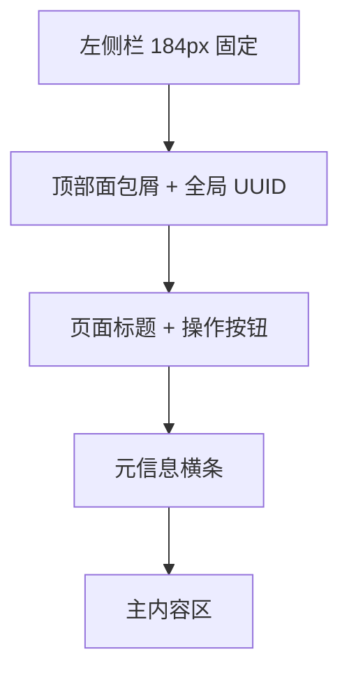

# 官方 UI 视觉与布局规格

依据：`docs/reference-screenshots/` 中 27 张官方界面截图（清单见该目录 `MANIFEST.md`）。
这些是重建 UI 时的**强制参考**——布局、信息层级、控件形态应与之对齐。

## 全局骨架

### 左侧栏

- 宽度约 **184 px**，深色（近 `#0a0a0a`），与主内容区之间有细分隔线。
- 顶部：品牌字标 `SPACE SAFETY`（全大写、加宽字距）。
- 环境横幅：staging 时为**橙色实心条**，文字 `STAGING`；
  production 不显示。这是最重要的环境提示，必须复刻。
- 其下：`YYYY-MM-DD HH:mm:ss UTC` 实时时钟，等宽字体。
- 搜索框：占位符 `Search (/)`，快捷键 `/`。
- 导航项（图标 + 文本，选中态为白色胶囊背景 + 深色文字）：

  | 项 | 说明 |
  |---|---|
  | Home | 总览 |
  | Docs | 文档 |
  | Operators | 运营方列表 |
  | Objects | 对象（卫星）列表 |
  | Trajectories | 轨迹列表 |
  | Conjunctions | 交会事件列表 |
  | Users | 用户（仅管理员） |
  | Keys | API 凭证 |
  | Feedback | 反馈 |

### 顶栏

- 左侧：面包屑（图标 + 当前层级，如 `Operators`）。
- 右侧：当前页面实体的 **完整 UUID**，等宽字体、低对比度灰色。

### 页面标题区

- 大号标题：列表页为类名（`SpaceX`），详情页为 `实体类型 + UUID 前 8 位`
  （如 `Conjunction d0ed43cd`、`Trajectory 013a0648`）。
- 右侧主操作按钮：`Edit`（带下拉箭头）、`Create object`、`Download ▾`。

## 元信息横条

详情页标题下方一行，字段之间用竖线分隔，**标签在上（灰、小号）、值在下（等宽、白色）**：

- 交会页：`Collision Probability` · `Initial TCA (UTC)` · `Created At (UTC)` · `Updated At (UTC)`
- 轨迹页：`Screened Status`（胶囊） · `Screened At (UTC)` · `Created At (UTC)` · `Uploaded At (UTC)`

## 数据表

- 表头：小号大写灰字，左侧对齐，列可排序（`Name ↕`）。
- 行：细下边框，hover 高亮。
- 布尔值渲染为**胶囊徽章**：`true` 绿色描边，`false` 红色描边。
- 计数提示在表格标题右侧，形如 `Showing 50 of >10000 objects`（灰色小字）。

### 筛选栏

- 左侧漏斗图标按钮，右侧齿轮（列设置）按钮。
- 每个筛选项为「字段名 + 操作符下拉 + 值输入」三段式：
  `Alive [equals ▾] [true ▾]`、`Name [contains ▾] [_]`、`NORAD Id [equals ▾] [_]`。

## 键值信息卡

两列表格形态：左列深灰底、固定宽度；右列为值。用于对象属性：

| 交会页 Object 1/2 | 轨迹页 |
|---|---|
| Operator Name | Operator |
| Object Name | Object |
| Object NORAD Id | Object NORAD Id |
| Object Alive | State Source（胶囊） |
| Object Maneuverable | Type（胶囊） |
| Object Hard Body Radius (m) | Start At (UTC) / End At (UTC) |

## 图表规范

统一深色主题：背景透明、网格线极淡、坐标轴标签灰色小字。

| 图表 | 位置 | 关键要素 |
|---|---|---|
| **Mean Orbital Elements** | 轨迹页右侧 | 折线 + 散点；下方切换 `SMA / Inc / Ecc / RAAN / AoP / MA` |
| **Prediction Consistency** | 交会页双栏 | R 方向误差 + 标准差竖线；图例区分 `operator_ephemeris`（橙）与 `spacex_optical`（蓝）；X 轴 `Creation Time (hrs Tgo)` 反向 |
| **Prediction Error** | 对象页 | 绿线 + 1σ/3σ 色带（绿/红）；Y 轴 `Position Error (m)` |
| **Prediction Error CDF** | 对象页 | 理想以 0 为中心 |
| **Mahalanobis Distance** | 对象页 | 单维马氏距离 |
| **Mahalanobis CDF** | 对象页 | 实测 vs χ²(k=1) 虚线基准 |

### 图表控件行（对象页「Prediction Accuracy」）

`Prediction Source` / `Reference Source` / `Prediction Horizon`（如 `3h`）/
`Axis`（`Radial` / `InTrack` / `CrossTrack`）/ `From`（`now-7d`）/ `To`（`now`）。

### 交会页图表控件行

`Error:` `R | T | N | Total | m | Mahal.` · `Time:` `Observation | Creation | UTC | hrs Tgo`
（当前选中项为白色胶囊/浅底）。

## CDM 表（轨迹页底部）

列：`Id` · `Conjunction` · `Is Active`（胶囊） · `Collision Probability` ·
`TCA (UTC)` · `Object 1 Name` · `Trajectory 1 State Source`（彩色胶囊） ·
`Object 2 Name` · `Trajectory 2 State Source`（彩色胶囊） · `Created At (UTC)` ·
`File`（`json` / `kvn` 两个下载图标）。

**State Source 配色**：`operator_ephemeris` 橙色描边，`spacex_optical` 蓝色描边。

## 配色

| 用途 | 值 |
|---|---|
| 页面背景 | 近黑 `#0a0a0a` |
| 卡片/表格背景 | 比背景略亮 |
| 卡片左边标签列 | 中灰 `#2a2a2a` 左右 |
| 主文本 | 近白 |
| 次级文本 | 灰 `#9a9a9a` |
| 强调/链接 | 蓝色 |
| 成功 true | 绿 |
| 失败 false / 高风险 | 红 |
| Staging 横幅 | 橙 `#f5a623` 左右 |
| operator_ephemeris | 橙 |
| spacex_optical | 蓝 |
| 图表主数据 | 亮绿 / 橙 / 蓝（按图） |

字体：界面无衬线；**所有 UUID、时间、数值、表标识一律等宽字体**。

## 待补充

- 截图未覆盖：`Home` 总览页、`Objects` 列表页、`Keys` 页、登录/凭证页。
  这些按现有模式（左侧栏 + 标题 + 筛选栏 + 表格）推导实现。
- 3D 轨道视图官方未公开截图，属我方扩展能力，不受此规格约束。
